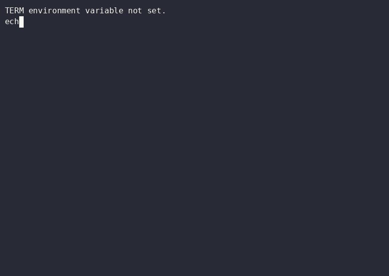

<p align="center"></p>

> **⚡ TURBO FLOW — LA CAPA DE REGLAS PARA CÓDIGO ESCRITO POR IA.**
> Un solo producto vive aquí: [`rig-lite/`](rig-lite/) — un kit de gobernanza portátil. No empaqueta ningún harness, no instala nada, solo depende de bash. Suéltalo en cualquier repo y tus agentes obtienen leyes con dientes.

   

## Trae tu propio harness

Turbo Flow no empaqueta ningún agente ni orquestador. Nombra los harnesses por **rol** y funciona con cualquier herramienta que lea `AGENTS.md` y pueda ejecutar bash:

| Rol | Quién | Cómo lo usa el kit |
|---|---|---|
| **Constructor** | ZCode (GLM), Claude Code, Codex, Gemini, Grok | `gate.sh --builder <cli>` conoce la familia; cualquiera puede construir |
| **Revisor** | Claude Code o Codex CLI — nunca la familia del constructor | el gate lo detecta solo y rechaza la revisión de la misma familia |
| **Orquestación** (opcional) | Ruflo, como mod de Claude Code | tráelo si quieres swarms — al kit le da igual |

**ZCode construye · Claude Code revisa (con el mod de Ruflo instalado cuando quieres orquestación) · Codex respalda la revisión.** Ese ciclo corre en producción en este repo hoy: cada PR desde que llegó rig-lite (v5.0) fue construido por una familia, revisado por otra y fusionado por un humano.

## 🎬 El demo — grabado en un Codespace limpio, nada preinstalado



Un Codespace limpio arranca el devcontainer de este repo y el kit se prueba a sí mismo: suite de auto-tests fail-closed y una corrida del gate en vivo (CLI del revisor stubbeado; sin API keys en la máquina de grabación). La grabación es anterior al lean pivot (muestra el contenedor previo del repo); el contenedor actual corre el self-test directamente en su `postCreate`, y el grabador ahora recorre ese flujo. Reproducible con [`demo/record-rig-lite-demo.sh`](demo/record-rig-lite-demo.sh).

## 🎬 El demo de arranque — sin menú, directo al rig


Un Codespace limpio desde `main` (sin autenticar): el primer shell dispara el arranque (sin menú — ese es el punto), **Claude Code + Codex + Ruflo se instalan de forma visible**, luego tmux arranca con las 5 ventanas — cada una aterrizando **dentro** de su harness. El GIF recorre todas las ventanas: claude (bienvenida de primer uso), claude+ruflo (con los plugins cargados), codex (pantalla de inicio de sesión en esta máquina nueva), el dashboard de tokens en vivo, y un shell libre con la ayuda del gate. El revisor es la ventana con una **familia de modelo diferente** al constructor — la revisión entre familias es la ley del kit.

## El gate sobrevivió 17 rondas de revisión

`rig-lite/gate.sh` fue revisado por una familia de modelos que no lo escribió — y recibió **REVISE diecisiete veces** antes de ganar su APPROVED (contado desde el propio log JSONL del gate). Los hallazgos son exactamente la clase que el gate existe para atrapar: un agujero de inyección de prompt que dejaba que un diff se aprobara solo, una ruta fail-open que saltaba la revisión, un bug de quoting que enterraba tests fallidos, un silent-reviewer mal diagnosticado. Cada fix se volvió un self-test. Desde v5.4 el gate también se aplica la disciplina a sí mismo: un PR pasado `GATE_ROUND_CAP` (default 3) rondas se niega a la ronda N+1 — exit `4`, el fork continuar/estacionar pasa al humano — en vez de quemar otra ronda en silencio.

## rig-lite — un kit, diez minutos, cero dependencias nuevas

| archivo | qué te da |
|---|---|
| [`gate.sh`](rig-lite/gate.sh) | gate de revisión entre modelos — checks deterministas primero (son gratis), luego un revisor de **otra familia** debe devolver `APPROVED` / `REVISE` parseable. Fail-closed; nunca fusiona. `--pr <n>` gatea un PR de GitHub y publica el veredicto como comentario. Cada veredicto queda **clavado al head que gateó** (`gated-head:` en el comentario + commit status en ese SHA exacto) — commits nuevos dejan el PR sin gatear otra vez y `--sweep` lo re-gatea en vez de confiar en una aprobación vencida. El revisor solo puede bloquear por defectos que **este diff introduce** (regla PRE-EXISTING — lo idéntico-en-la-base es nota no-bloqueante). Las rondas tienen **tope** (`GATE_ROUND_CAP`, default 3): pasado el tope el gate sale con `4` y el fork continuar / estacionar / reestructurar es del humano, no de otra auto-ronda (`GATE_FORCE=1` lo sobreescribe a conciencia). Y desde la ronda 2 el revisor recibe los hallazgos de la ronda anterior como DATA depurada — lo ya atendido deja de volver. |
| [`protect.sh`](rig-lite/protect.sh) | convierte el gate en una regla de GitHub, no una promesa: un comando activa la protección de rama con el veredicto del gate como **chequeo requerido** (`gate-verdict`, fijado por `gate.sh` sobre el SHA exacto que revisó), así `main` no puede recibir un PR sin gatear ni por accidente. **No** hace que solo humanos fusionen: `--require-review` exige una *revisión* aprobatoria (un permiso de cuenta, no prueba de quién lo tecleó), y cualquier cuenta con permiso de merge puede fusionar un PR aprobado — que el merge quede solo en humanos es una decisión de control de acceso (qué cuentas tienen permiso de merge) que la protección no puede tomar por ti. `--dry-run` / `--status` para ver antes de tocar. Su workflow compañero [`gate-check.yml`](.github/workflows/gate-check.yml) re-verifica en cada push y, cuando el gate publica APPROVED, pone verde el chequeo del PR por sí solo — los PRs de fork reciben el re-run de un clic, porque GitHub no vincula sus runs al PR. |
| [`wt.sh`](rig-lite/wt.sh) | un worktree aislado por escritor en paralelo. |
| [`init-repo.sh`](rig-lite/init-repo.sh) | onboarding de un comando para cualquier repo: un `AGENTS.md` delgado + el symlink `CLAUDE.md → AGENTS.md`. Nunca pisa archivos existentes. |
| [`specs/`](rig-lite/specs/) | plantillas de spec + contrato UAT: plan antes de construir, verificar contra la app desplegada. |
| [`digest.sh`](rig-lite/digest.sh) | salud de tu flota de repos en un comando: cola de merges unida a veredictos del gate, working copies sucios, liveness de sitios, codespaces viejos. |
| [`automations/`](rig-lite/automations/README.md) | el tier de fondo como pack portable de prompts: 9 tareas programadas + dos formas de agendarlas. |
| [`secret.sh`](rig-lite/secret.sh) | secretos cifrados en reposo, backend autodetectado (Keychain → libsecret → age → texto plano con advertencia). `list` muestra nombres, nunca valores. |
| [`memory.md`](rig-lite/memory.md) + [`memory/`](rig-lite/memory/) | el patrón de memoria versionado en git: índice, decisiones, gotchas, inbox. |
| [`tokens.py`](rig-lite/tokens.py) | dashboard en vivo de consumo de tokens entre **zcode + claude + codex + gate** — lee los datos locales de cada CLI en solo-lectura; `--watch`, `--json`, self-test con fixtures fijando la zona horaria, cubriendo cada adaptador (incluye filas malformadas). El primer drop open-core desde Turbo Rig. En macOS la corrida por defecto además lee el token OAuth de Claude del Keychain y consulta el endpoint de uso de Anthropic — `--no-quota` salta ambos. |
| [`hooks/pre-commit`](rig-lite/hooks/pre-commit) | guardián de borrados: las eliminaciones staged se anuncian en voz alta. |
| [`constitution.md`](rig-lite/constitution.md) | las leyes — constructor ≠ revisor, los agentes nunca fusionan, secretos cifrados, estado en disco. |
| [`self-test.sh`](rig-lite/self-test.sh) | la suite fail-closed del kit; avisa cuando el coverage de shellcheck se omite. |

Cuando la instalación termina, aterrizas **dentro de un rig tmux de 5 ventanas** — y esa instalación ya no pregunta: el arranque **autoinstala el par por defecto (Claude Code + Codex + el cableado de Ruflo)** de forma visible en el primer shell; el menú interactivo queda disponible a pedido (`./setup-harness.sh`) para GLM, todo, o saltar. `claude` (el revisor Anthropic) · la **ventana constructora** — `claude-glm` si elegiste la ruta GLM (un par entre familias real con la ventana 1), si no `claude` simple y honestamente etiquetada de la misma familia (cáblala luego: `./setup-harness.sh --glm`), con los plugins de ruflo ya cargados (los comandos slash se ejecutaron al instalar — verifícalo cuando quieras con `/plugin`) · `codex` · el **dashboard de tokens** en vivo (`rig-lite/tokens.py --watch`) · un shell libre. Desconéctate cuando quieras; la sesión sobrevive (cada terminal nuevo se auto-conecta al mismo rig — es el diseño). `TF_NO_TMUX=1` lo desactiva todo: sin instalación de arranque ni auto-attach.

## Instalación en diez minutos

```bash
# desde cualquier repo que quieras gobernar:
bash /ruta/a/turbo-flow/rig-lite/init-repo.sh
export PATH="$HOME/.local/bin:$PATH"              # tf vive aquí   # escribe AGENTS.md + instala tf, nunca pisa
tf test                                            # demuestra el kit (396 checks)
tf gate --builder <tu-cli>                       # gatea tu primer cambio
```

Sin Codespace no pasa nada — es bash. ¿Quieres el tour de 30 segundos en contenedor? Abre este repo en un Codespace; el `postCreate` corre el self-test e instala `tf`.

## Tus primeros cinco minutos en el rig

En un Codespace (o tras correr `bash workspace.sh`), estás dentro de una sesión tmux de 5 ventanas. Esto es lo que sigue:

### 1. Inicia sesión (una vez por máquina — el único paso manual)

```
Ctrl+B 0    → salta a la ventana claude, escribe /login (OAuth en navegador)
Ctrl+B 4    → salta al shell, escribe codex login (navegador); luego Ctrl+B 2
```

Después de eso, cada ventana abre lista para trabajar, para siempre en esta máquina.

### 2. Mira alrededor

| Teclas | Qué ves |
|---|---|
| `Ctrl+B 0` | **claude** — tu revisor cuando la ventana 1 es claude-glm; si no, usa codex (ventana 2) para revisar |
| `Ctrl+B 1` | **constructor** — claude-glm si está cableado, si no claude con ruflo cargado |
| `Ctrl+B 2` | **codex** — tu carril OpenAI (ruflo accesible vía MCP) |
| `Ctrl+B 3` | **tokens** — consumo en vivo de los tres harnesses, siempre actualizando |
| `Ctrl+B 4` | **shell** — bash libre para git, builds, lo que sea |
| `Ctrl+B d` | desconéctate (vuelve cuando quieras — la sesión sobrevive) |

### 3. Gatea tu primer cambio

En la ventana shell (`Ctrl+B 4`), desde cualquier rama que tú o un agente construyeron:

```bash
# demuestra que el kit funciona:
tf test

# gatea una rama (el CLI que ESCRIBIÓ el código se identifica — otra familia revisa):
tf gate --builder claude     # si claude lo escribió → un revisor no-Anthropic lo revisa
tf gate --builder glm       # si claude-glm lo escribió → claude revisa (entre familias)

# gatea un PR de GitHub (el veredicto se publica como comentario en el PR):
tf gate --pr 7 --builder codex           # codex lo escribió → claude revisa

# gatea todos los PRs abiertos sin veredicto:
# (sweep runs per-PR with its own builder: rig-lite/gate.sh --sweep)
```

El gate sale `0` (aprobado) o `1` (revise — corrige y vuelve a correr). **Nunca fusiona; eso lo haces tú.**

### 4. Tu ciclo diario

```bash
tf wt mi-feature         # worktree aislado para trabajo paralelo
# ... construye en ventana 1, pide a una familia DIFERENTE (ventana 0 o 2) leer el diff ...
tf gate --builder <quien-lo-escribio>  # gatea antes del PR
# ... push, abre el PR, gatealo ...
tf digest                # salud de la flota: cola de merges × veredictos × liveness
```

¿Desconectado y quieres volver? En un Codespace, cada terminal nuevo se auto-conecta. En local: `bash workspace.sh` de nuevo.

## A dónde se fue el entorno v4

Turbo Flow v4 empaquetaba y cableaba un entorno Claude Code + Ruflo. Ruflo creció su propio onboarding (`npx ruflo@latest init wizard`, marketplace de plugins, memoria y consola integradas), lo que jubiló la razón de ser de un repo envoltorio. La cadena de instalación v4 vive en los tags `v1.0.1 → v4.0`; la línea v5 es gobernanza-primero y agnóstica de orquestación.

## Únete a la beta privada

El kit es el extracto portable de **Turbo Rig** — gate + constitución + memoria + automatizaciones corriendo como un sistema integrado, en tu máquina, a través de tus repos.

- **Aplicar / página del producto** → [turbo-rig.vercel.app](https://turbo-rig.vercel.app) (EN/ES)
- **Deep dive** → [turbo-rig-deep-dive.vercel.app](https://turbo-rig-deep-dive.vercel.app) · **Escena 3D** → [turbo-rig-deep-dive-3d.vercel.app](https://turbo-rig-deep-dive-3d.vercel.app)

**Feedback de la beta:** abre un issue o una discusión aquí — este repo es el tracker público de la beta.

## ¿Importa realmente que constructor ≠ revisor?

El constructor nunca es su propio revisor — una decisión de diseño, no algo que midiera la semana auditada. Lo que midió una semana reciente construyendo Turbo Rig con Turbo Rig es la severidad del gate: **141 PRs · 868 veredictos · 687 REVISE (79%) · 104 lanes en paralelo** — los veredictos cubren la ventana del gate (16–21 de septiembre), los merges la semana completa, y cada merge fue sostenido por un humano. Cada número re-derivado de los registros primarios en el dossier público: https://www.turbo-rig.com/evidence (la cifra de 116 tareas citada aquí antes sin atribución es un resultado externo publicado — Xiang et al., “Cross-Model LLM Code Review,” Agentic SE @ KDD’26, arXiv:2607.21656 — no son nuestros datos; se cita con atribución desde ahora).

## Sobre Adventure Wave Labs

**Adventure Wave Labs** construye Turbo Flow y Turbo Rig — packaging, automatización de setup, y la capa de gobernanza que aguanta cuando los agentes aceleran. El núcleo de orquestación referenciado por v4 fue [Ruflo](https://github.com/ruvnet/ruflo) de rUv; Turbo Flow lo integra — y ahora lo señala — en lugar de reconstruirlo.

<div align="center">

**Turbo Flow v5.2 — la capa de reglas. Un kit, cualquier harness, los humanos fusionan.**

</div>

## Licencia

MIT — Copyright (c) 2025-2026 Adventure Wave Labs
