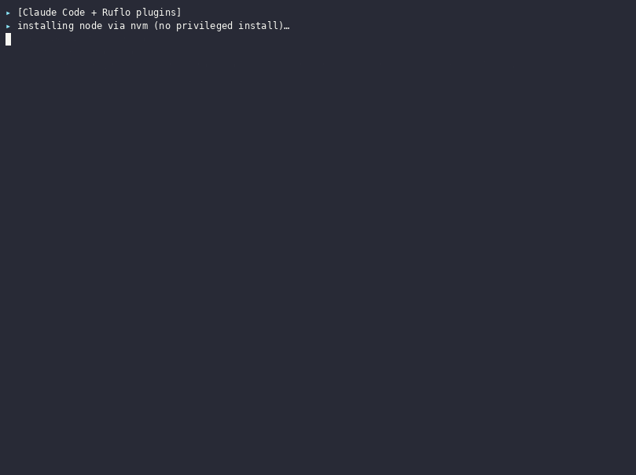
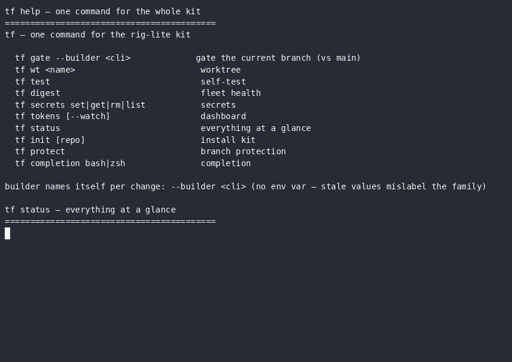

<p align="center"></p>

<p align="center"></p>

> **⚡ TURBO FLOW — THE RULES LAYER FOR AI-WRITTEN CODE.**
> One product lives here: [`rig-lite/`](rig-lite/) — a portable governance kit. It ships no harness, installs nothing, and depends only on bash. Drop it into any repo and your agents get laws with teeth.

**Turbo Flow is an open-source project by [Adventure Wave Labs](https://www.adventurewavelabs.space/) (Marcus Patman).** Versions 1–4 (2025–2026) packaged an agentic development environment around Claude Code and Ruflo — at its peak, 215+ MCP tools and 60+ agents. In September 2026 the project pivoted to a thinner, governed approach, and by v5.2 (October 2026) the orchestration stack was fully removed: Turbo Flow is now the rules layer (rig-lite), and the integrated successor, **Turbo Rig**, runs in private beta. Site: [turboflow.online](https://www.turboflow.online/) · full story: [why Turbo Flow became Turbo Rig](https://www.turboflow.online/why-turbo-flow-became-turbo-rig/) · [version history](https://www.turboflow.online/versions/).

   

## Bring your own harness

Turbo Flow bundles no agent and no orchestrator. It names harnesses by **role**, and works with any tool that reads `AGENTS.md` and can run bash:

| Role | Who | How the kit uses it |
|---|---|---|
| **Builder** | ZCode (GLM), Claude Code, Codex, Gemini, Grok | `gate.sh --builder <cli>` knows the family; anyone can build |
| **Reviewer** | Claude Code or Codex CLI — never the builder's family | the gate auto-detects and refuses same-family review |
| **Orchestration** (optional) | Ruflo, as a Claude Code mod | bring it if you want swarms — the kit doesn't care |

**ZCode builds · Claude Code reviews (Ruflo mod installed when you want orchestration) · Codex backs up the review.** That loop runs in production on this repo today: every PR since rig-lite landed (v5.0) was built by one family, reviewed by another, merged by a human.

## 🎬 The demos — the boot and the daily driver

### The boot (recorded in a fresh Codespace)



A fresh Codespace from `main` (unauthenticated): the first shell triggers the boot (no menu), **Claude Code + Codex + Ruflo install visibly**, then tmux fires with all 5 windows — each landing **inside** its harness.

### The daily driver — `tf` (one command for everything)



Recorded on the same Codespace: `tf help` shows every subcommand, `tf status` gives the at-a-glance view (repo, gate verdict counts, tree health), `tf gate` fails closed without `--builder`, `tf tokens` shows the live dashboard, and `tf test` runs the full suite. The `tf` command is installed automatically in Codespaces and by `init-repo.sh` anywhere else.

## The gate survived 17 rounds of review

`rig-lite/gate.sh` was itself reviewed by a model family that didn't write it — and got **REVISE'd seventeen times** before earning APPROVED (counted from the gate's own JSONL log). The findings are exactly the class the gate exists to catch: a prompt-injection hole that let a diff approve itself, a fail-open path that skipped review entirely, a quoting bug that swallowed failing tests, a silent-reviewer misdiagnosis. Every fix became a self-test. **Builder ≠ reviewer isn't a slogan in this repo — it's the reason this script is trustworthy.** Since v5.4 the gate also enforces this discipline on itself: a PR past `GATE_ROUND_CAP` (default 3) rounds refuses round N+1 — exit `4`, the continue/park fork handed to the human — instead of quietly burning another round.

## rig-lite — one kit, ten minutes, no new dependencies

| file | what it gives you |
|---|---|
| [`tf`](rig-lite/tf) | **one command for everything** — `tf gate`, `tf test`, `tf status`, `tf wt`, `tf secrets`, `tf tokens`, `tf digest`, `tf init`, `tf protect`. Installed by `init-repo.sh` and by the Codespace boot. |
| [`gate.sh`](rig-lite/gate.sh) | a cross-model review gate — deterministic checks first (they're free), then a reviewer from a **different model family** must return a parseable `APPROVED` / `REVISE`. Fail-closed; never merges. `--pr <n>` gates a GitHub PR and posts the verdict as a comment; `--sweep` gates every open PR that has no verdict yet; `-C <repo>` gates another checkout. Every verdict lands in a local JSONL log the digest joins (comment fetch needs gh ≥ 2.48 for `--slurp`; older gh sweeps WARN and re-gate — the safe direction). Verdicts are **pinned to the head they gated** (`gated-head:` in the comment, commit status on that exact SHA) — new commits make the PR ungated again and `--sweep` re-gates it instead of trusting a stale approval. The reviewer may only block for defects **this diff introduces** (the PRE-EXISTING rule — identical-in-base defects are non-blocking notes). Rounds are **capped** (`GATE_ROUND_CAP`, default 3): past the cap the gate exits `4` and the continue / park / restructure fork goes to a human, not to another auto-round (`GATE_FORCE=1` overrides consciously). And on round 2+ the reviewer receives the prior round's findings as scrubbed DATA — addressed items stop coming back. |
| [`protect.sh`](rig-lite/protect.sh) | makes the gate a GitHub rule, not a promise: one command turns on branch protection with the gate's verdict as a **required status check** (`gate-verdict`, set by `gate.sh` on the exact SHA it reviewed), so `main` can't take an un-gated PR even by accident. It does **not** make merging human-only: `--require-review` demands an approving *review* (an account permission, not proof of who typed it), and any account with merge rights can still merge an approved PR — keeping merges human-only is an access-control decision (whose accounts hold merge rights) that protection can't make for you. `--dry-run` / `--status` to look before touching. Its companion workflow [`gate-check.yml`](.github/workflows/gate-check.yml) re-checks on every push and, once the gate posts APPROVED, flips the PR's own check green by itself — fork PRs get the exact one-click re-run instead, because GitHub won't link their runs to the PR. |
| [`wt.sh`](rig-lite/wt.sh) | an isolated worktree per parallel writer: `wt <name>` creates `.worktrees/<name>` + branch, `--clean` tidies up after merge. |
| [`init-repo.sh`](rig-lite/init-repo.sh) | one-command onboarding for any repo: a thin `AGENTS.md` (constitution pointer + project cheat-sheet) and the `CLAUDE.md → AGENTS.md` symlink. Never clobbers existing files. |
| [`specs/`](rig-lite/specs/) | the spec + UAT contract templates: plan before build, verify behavior against the deployed app. |
| [`digest.sh`](rig-lite/digest.sh) | one command, one file: repo health for your whole fleet — merge queue joined with gate verdicts, merged PRs, dirty/behind working copies, site liveness, stale codespaces, repo-hygiene gaps. |
| [`automations/`](rig-lite/automations/README.md) | the background tier as a portable prompt pack: 9 scheduled tasks (morning digest, security scan, memory consolidation, weekly retro, repo-hygiene pass, site sentinel, gate canary, portability canary, nightly sweep) plus two ways to schedule them. |
| [`secret.sh`](rig-lite/secret.sh) | encrypted-at-rest secrets, backend auto-detected (macOS Keychain → libsecret → age → loudly-warned chmod-600 plaintext). `set/get/rm/list` — listing shows names, never values; values never appear in `ps`. |
| [`memory.md`](rig-lite/memory.md) + [`memory/`](rig-lite/memory/) | the git-versioned memory pattern: index, decisions, gotchas, project index, inbox — agents forget, git doesn't. |
| [`tokens.py`](rig-lite/tokens.py) | live token-burn dashboard across **zcode + claude + codex + gate** — reads each CLI's local usage data read-only; `--watch` live view, `--json`, TZ-pinned fixture self-test covering every adapter (including malformed-shape rows). The first open-core drop from Turbo Rig. On macOS the default run also reads the Claude OAuth token from the Keychain and calls Anthropic's usage endpoint for plan bars — `--no-quota` skips both. |
| [`hooks/pre-commit`](rig-lite/hooks/pre-commit) | deletion guard: staged deletions print loudly instead of silently vanishing. Warn-only, fail-open. |
| [`constitution.md`](rig-lite/constitution.md) | the laws — builder ≠ reviewer, agents never merge, worktrees for parallel writers, secrets encrypted, state on disk. |
| [`self-test.sh`](rig-lite/self-test.sh) | the kit's own fail-closed test suite (hundreds of checks); says so when shellcheck-gated coverage is skipped. |

## Ten-minute install

```bash
# one-liner (stages ./rig-lite from a pinned, checksum-verified release):
curl -fsSL https://github.com/marcuspat/turbo-flow/raw/main/rig-lite/install.sh | bash

# from any repo you want to govern:
bash /path/to/turbo-flow/rig-lite/init-repo.sh   # writes AGENTS.md + installs tf, never clobbers
export PATH="$HOME/.local/bin:$PATH"              # tf lives here (init warns if not on PATH)
tf test                                            # prove the kit (322 checks)
tf gate --builder <your-cli>                       # gate your first change
tf status                                          # everything at a glance
```

No Codespace? Fine — it's bash. Want the 30-second container tour anyway? Open this repo in a Codespace; `postCreate` runs the self-test and installs `tf` on PATH automatically. That's the whole install surface.

## Your first five minutes in the rig

In a Codespace (or after running `bash workspace.sh`), you're inside a 5-window tmux session. Here's what to do:

### 1. Log in (once per box — the only manual step)

```
Ctrl+B 0    → jump to the claude window, type /login (browser OAuth)
Ctrl+B 4    → jump to the shell, type codex login (browser); then Ctrl+B 2
```

After that, every window opens ready for work, forever on this box.

### 2. Look around

| Keys | What you see |
|---|---|
| `Ctrl+B 0` | **claude** — reviewer when window 1 is claude-glm; otherwise use codex (window 2) to review |
| `Ctrl+B 1` | **builder** — claude-glm if wired, else claude with ruflo plugins loaded |
| `Ctrl+B 2` | **codex** — your OpenAI lane (ruflo reachable via MCP) |
| `Ctrl+B 3` | **tokens** — live burn across all three harnesses, always updating |
| `Ctrl+B 4` | **shell** — free bash for git, builds, anything |
| `Ctrl+B d` | detach (come back any time — the session survives) |

### 3. Gate your first change

The `tf` command is installed automatically in Codespaces (and by `init-repo.sh` anywhere else). In the shell window (`Ctrl+B 4`), from any branch you or an agent built:

```bash
# prove the kit works:
tf test

# gate a branch — the builder names itself (--builder is required):
tf gate --builder claude    # if claude wrote it → a non-Anthropic reviewer checks it
tf gate --builder glm       # if claude-glm wrote it → claude reviews (cross-family)

# gate a GitHub PR (verdict posted as a comment on the PR):
tf gate --pr 7 --builder codex    # codex wrote it → claude reviews

# everything at a glance:
tf status
```

The gate exits `0` (approved) or `1` (revise — fix and re-run). **It never merges; you do.**

Full command list: `tf help`

### 4. Your daily loop

```bash
tf wt my-feature             # isolated worktree for parallel work
# ... build in window 1, ask a DIFFERENT family (window 0 or 2) to read the diff ...
tf gate --builder <who-wrote-it>  # gate before the PR (defaults to --base main)
# ... push, open the PR, gate it ...
tf digest                         # fleet health: merge queue × verdicts × site liveness
```

Detached and want back in? In a Codespace, every new terminal auto-attaches. Locally: run `bash workspace.sh` again.

## Harnesses — installed by the boot, menu on demand

The kit ships no harness, and the boot no longer asks: a fresh Codespace **auto-installs the default pair (Claude Code + Codex + the Ruflo wiring)** on the first shell, visibly, then drops you straight into the tmux rig. The interactive menu is still there on demand — [`setup-harness.sh`](setup-harness.sh) — for GLM, all-of-the-above, or skip:

| choice | what you get |
|---|---|
| **Claude Code** | Anthropic login · Ruflo installed as plugins (`marketplace add ruvnet/ruflo` + console/mods) |
| **Codex** | OpenAI login · Ruflo wired through **MCP** (`~/.codex/config.toml`) |
| **GLM** | Claude Code on your **GLM Coding Plan** key (docs.z.ai, Anthropic-protocol endpoint) via a dedicated `claude-glm` launcher — plain `claude` stays your Anthropic reviewer, so builder ≠ reviewer survives by construction |

When the install finishes, you land **inside a 5-window tmux rig**: `claude` (the Anthropic reviewer) · the **builder window** — `claude-glm` when you chose the GLM path (a genuine cross-family pair with window 1), otherwise plain `claude` honestly labeled same-family (wire it later: `./setup-harness.sh --glm`), with the ruflo plugins pre-loaded (the slash commands were executed at install time — verify any time with `/plugin`) · `codex` · the **tokens dashboard** live (`rig-lite/tokens.py --watch`) · a free shell. Detach any time; the session survives (every new terminal auto-attaches to the same rig — that's the design). `TF_NO_TMUX=1` is a total opt-out: no boot install, no auto-attach. Keys are read hidden and stored with `600` permissions, and everything installs user-space (nvm + npm global prefix). The GLM path is fail-closed: a missing or incomplete `glm.env` makes `claude-glm` refuse to run rather than silently fall back to an Anthropic session. One shared surface, stated plainly: Ruflo plugins installed via the Claude/GLM paths load in **both** `claude` and `claude-glm` (they're tooling, not model — the reviewer's model stays Anthropic, so builder ≠ reviewer holds). `--claude` / `--codex` / `--glm` flags run it non-interactively.

## Where the v4 environment went

Turbo Flow v4 packaged and wired a Claude Code + Ruflo environment. Ruflo grew its own onboarding (`npx ruflo@latest init wizard`, plugin marketplace, built-in memory and console), which retired the reason a wrapper repo existed. The v4 install chain lives on in the `v1.0.1 → v4.0` tags; the v5 line is governance-first and orchestration-agnostic.

## Join the private beta

The kit is the portable extract of **Turbo Rig** — gate + constitution + memory + automations running as one integrated system, on your machine, across your repos.

- **Apply / product page** → [turbo-rig.vercel.app](https://turbo-rig.vercel.app) (EN/ES)
- **Deep dive** → [turbo-rig-deep-dive.vercel.app](https://turbo-rig-deep-dive.vercel.app) · **3D scene** → [turbo-rig-deep-dive-3d.vercel.app](https://turbo-rig-deep-dive-3d.vercel.app)

**Beta feedback:** open an issue or start a discussion here — this repo is the beta's public tracker.

## Does builder ≠ reviewer actually matter?

The builder is never its own reviewer — a design choice, not something the audited week measured. What one recent week of building Turbo Rig with Turbo Rig measured is the gate's strictness: **141 PRs · 868 gate verdicts · 687 REVISE (79%) · 104 parallel lanes** — verdicts cover the gate-live window (Sept 16–21), merges the full week, and every merge was held by a human. Every number re-derived from the primary logs in the public verification dossier: https://www.turbo-rig.com/evidence (the 116-task figure previously cited here without attribution is a published external result — Xiang et al., “Cross-Model LLM Code Review,” Agentic SE @ KDD’26, arXiv:2607.21656 — not our data; cited as such now). The badge at the top is the receipt.

## About Adventure Wave Labs

**Adventure Wave Labs** builds Turbo Flow and Turbo Rig — packaging, setup automation, and the governance layer that holds when the agents get fast. The orchestration core referenced by v4 was [Ruflo](https://github.com/ruvnet/ruflo) by rUv; Turbo Flow integrates, and now points at it, rather than rebuilding it.

<div align="center">

**Turbo Flow v5.2 — the rules layer. One kit, any harness, humans merge.**

</div>

## Ecosystem

Built with and powers these tools — star the ones you use:

| Repo | What it does |
|------|-------------|
| [**codescope**](https://github.com/adventurewave-labs/codescope) | Single-binary code-intelligence engine for AI agents — no cloud, no DB, no Python |
| [**secret-scan**](https://github.com/adventurewave-labs/secret-scan) | Rust secret scanner — obfuscation detection, up to ~1,200 files/sec measured |
| [**Sentinel**](https://github.com/marcuspat/Sentinel) | Deny-by-default agentic sysadmin: Investigate → Plan → Approve → Act in Rust |
| [**netrain**](https://github.com/marcuspat/netrain) | Matrix-style network monitor in Rust |

Orchestration, when you want it: [Ruflo](https://github.com/ruvnet/ruflo) as a Claude Code mod.

## Stay Connected

If Turbo Flow ships value for you, follow [@marcuspat](https://github.com/marcuspat) on GitHub — agentic tooling, Rust crates, and open-source infra drop regularly.

[](https://github.com/marcuspat)

## License

MIT — Copyright (c) 2025-2026 Adventure Wave Labs
